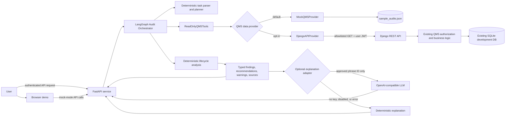
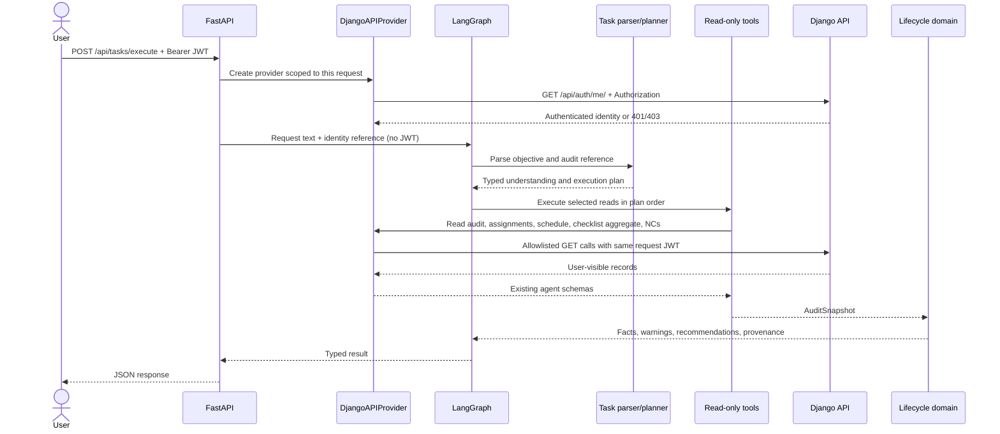
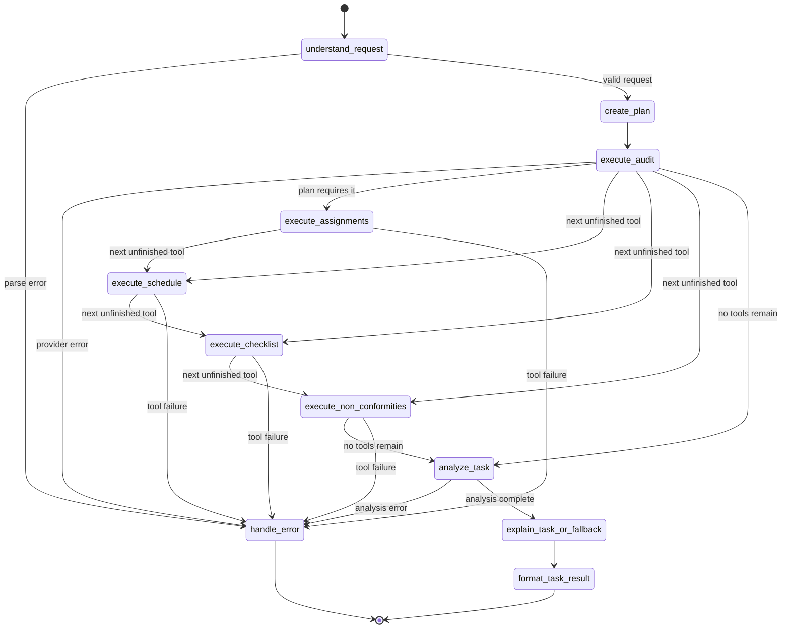
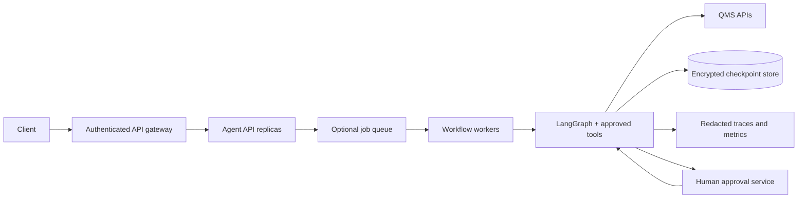

# QMS AI Agent — Technical Learning Notebook

This notebook explains the system that exists in this workspace, the engineering patterns it uses, and how those patterns could grow safely. It is based on the current source and the implementation history. Statements marked **Implemented**, **Planned**, or **Not implemented** distinguish working code from future ideas.

## 1. Project objective and product vision

The project is a separate Python service that reads the existing QMS Internal Audit & Compliance Management System and helps people understand audit status, identify recorded gaps, and plan lifecycle work. The long-term product vision is an autonomous, tool-driven agent that can coordinate internal audit and compliance work across connected QMS systems, subject to permissions and human approval.

The current service is a deliberately smaller first version:

- It reads from synthetic data by default, or from the existing Django REST API when `QMS_DATA_PROVIDER=django` is selected.
- It interprets a small set of natural-language request patterns using deterministic Python.
- LangGraph routes the request through one Audit Orchestrator and read-only tools.
- Python computes business facts and recommendations. An optional model can choose a short approved explanation phrase.
- It does not change QMS records, access the SQLite database directly, use RAG, or create multiple collaborating agents.

“Autonomous” currently means that a submitted task can be parsed, planned, and executed across selected read operations without a user manually selecting each tool. It does not mean that the service can act on or change the QMS.

## 2. Complete system architecture



The agent service never connects to the SQLite database. In Django mode it calls Django REST endpoints, and Django applies its existing authentication and object-visibility logic. The diagram shows the database only as the existing QMS backend's persistence layer.

### Main request sequence



The request-scoped provider is closed after the API response. The JWT is not part of the graph state or the LLM prompt.

## 3. Responsibilities: FastAPI, Django, LangGraph, and the domain

| Component | What it owns | What it deliberately does not own | Project implementation |
| --- | --- | --- | --- |
| FastAPI | HTTP routes, request/response validation, provider-mode configuration, request-scoped authentication setup, HTTP error translation | QMS lifecycle rules and direct database access | [`main.py`](agent-service/app/main.py) |
| Django REST API | Existing QMS authentication, role and object permissions, QMS data and business behavior | Agent planning or LLM prompts | `Backend/audits/`, `Backend/accounts/`, `Backend/config/` |
| LangGraph | Workflow nodes, state transitions, conditional routing, orchestration error paths | QMS business truth and authorization decisions | [`graph.py`](agent-service/app/agent/graph.py), [`state.py`](agent-service/app/agent/state.py) |
| Domain logic | Deterministic lifecycle facts, warnings, recommendations, and source references | Network calls, user authentication, model calls | [`lifecycle.py`](agent-service/app/domain/lifecycle.py) |
| Provider | Translating a provider's records and errors into agent schemas | Deciding business recommendations | [`base.py`](agent-service/app/providers/base.py), [`mock_qms.py`](agent-service/app/providers/mock_qms.py), [`django_api.py`](agent-service/app/providers/django_api.py) |
| Tool facade | A narrow set of operations that the orchestrator can call | Arbitrary HTTP access or write actions | [`qms_tools.py`](agent-service/app/tools/qms_tools.py) |
| Optional LLM adapter | Choosing among pre-approved explanation styles | Determining facts, statuses, permissions, or actions | [`openai_compatible.py`](agent-service/app/llm/openai_compatible.py), [`prompts.py`](agent-service/app/agent/prompts.py) |

This separation is a form of **layered architecture**: HTTP concerns, workflow concerns, domain decisions, and external data access remain in different places. For example, a Django 403 is translated at the provider/API boundary; it must not be “reasoned away” by a model.

## 4. Agent orchestration and execution flow

There are two related graphs in `AuditOrchestrator`:

1. The audit-analysis graph loads one snapshot, analyzes it, and optionally selects an approved explanation phrase.
2. The task graph first understands a request, creates a typed plan, executes its tools, analyzes the results, and formats a task response.

An end-to-end example:

```text
Request: "Find compliance gaps for audit IA-2026-003"
  1. Parser extracts reference IA-2026-003.
  2. Parser classifies compliance_gap_analysis.
  3. Planner selects audit, checklist, and non_conformities tools.
  4. Audit tool resolves the audit and returns internal id audit-1003 (mock)
     or a Django integer ID after resolving the visible audit list.
  5. Checklist and NC reads execute. Django mode uses aggregate checklist
     progress because item-level endpoints are not authorized for this user.
  6. Domain logic computes recorded checklist gaps and unresolved NCs.
  7. Findings include source references such as checklist_item/item-1003-2/result.
  8. Result contains the plan, completed steps, findings, recommendations,
     sources, unresolved policy notes, and deterministic explanation.
```

In the synthetic `IA-2026-003` sample, the checklist has two non-compliant results, one pending result, and one compliant result. Two linked NCs are respectively `OPEN` and `REWORK_REQUIRED`. These are fixture facts, not claims about real QMS data. In Django mode, exact item codes/questions are unavailable because the provider intentionally does not call the protected checklist-item endpoints; it can report aggregate counts and NC details returned by authorized APIs.

The tools execute sequentially in the plan's order. The current graph does not fan out independent calls in parallel, retry failed steps, or preserve a partial task response after a provider failure.

## 5. LangGraph state, nodes, edges, and conditional routing

### State

[`AgentState`](agent-service/app/agent/state.py) is a `TypedDict` with optional fields for the request, understanding, plan, audit record, tool results, snapshot, analysis, error, and final result. LangGraph nodes return partial dictionaries; LangGraph merges each node's update into the workflow state.

The state has no JWT field. In Django mode, the graph receives request text and an `AuditOrchestrator` whose tool facade holds a request-scoped provider. The identity context contains a request ID, principal ID, and system ID, not the bearer value.

### Task graph



`_next_task_node` checks `plan.required_tools` against `executed_tools` and chooses the next node. This makes tool selection data-driven: a compliance-gap plan can skip assignment and schedule reads, whereas a full audit overview includes them. The route map is a closed set of graph destinations; a plan cannot name an arbitrary Python function.

The simpler analysis graph is `START → load_context → analyze → explain_or_fallback → END`, with conditional transitions to `handle_error` when loading or analysis fails.

### Checkpointing

`AuditOrchestrator` accepts an optional LangGraph `BaseCheckpointSaver` and can supply a thread ID when one is configured. **No checkpointer is configured by the application today**, so graph state is invocation-scoped and not persisted. Durable state, resume behavior, retention, and tenant separation are future design work.

## 6. Natural-language task parsing and planning

[`task_planning.py`](agent-service/app/agent/task_planning.py) uses regular expressions and ordered intent patterns. It recognizes audit reference formats including mock IDs (`audit-1003`, `audit_1003`, `audit 1003`), legacy QMS-style IDs (`IA-2026-003`), and real-style codes (`AUD-2026-Q2`). The matched text is retained; Django lookup is then handled by the provider.

The four supported objectives are:

| Objective | Example request | Selected tools |
| --- | --- | --- |
| Audit analysis | `Analyze audit audit-1001` | Audit, assignments, schedule, checklist, NCs |
| Pending actions | `Identify pending actions for audit audit-1002` | Audit, assignments, schedule, checklist, NCs |
| Completion planning | `Plan to complete audit IA-2026-003` | Audit, assignments, schedule, checklist, NCs |
| Compliance gaps | `Find compliance gaps for audit AUD-2026-Q2` | Audit, checklist, NCs |

The parser classifies keywords such as “pending”, “completion”, and “compliance gaps”; it does not infer arbitrary intent as a general language model would. The planner maps each objective to a predefined tool list and rationale, then produces `ExecutionPlan` and `TaskPlanStep` Pydantic objects.

```python
reference_match = _AUDIT_REFERENCE.search(text)
if not reference_match:
    raise TaskParseError("invalid_task_request", "Include an audit ID ...")

return TaskUnderstanding(
    request_text=text,
    audit_reference=reference_match.group(0),
    objective=objective,
    objective_summary=summary,
)
```

The identifier is then passed to `ReadOnlyQMSTools.get_audit()` and on to the selected provider. In Django mode the provider resolves either an integer ID or audit code against the authenticated user's `GET /api/audits/` result before it fetches the detail.

**Trade-off:** deterministic parsing is cheap, debuggable, and avoids an LLM inventing an objective or selecting an unsafe tool. It is less flexible than free-form language understanding. Unsupported phrasing returns a typed `invalid_task_request` rather than being guessed.

**Common mistake:** broadening the regex without negative tests can make a longer unrelated string look like an audit code. Preserve the exact matched ID and test every accepted format plus malformed IDs.

## 7. Agent tools and tool execution

In agent engineering, a **tool** is a narrowly defined operation the orchestrator can invoke. These tools are ordinary Python methods behind [`ReadOnlyQMSTools`](agent-service/app/tools/qms_tools.py), not model-generated HTTP function calls. The current tool surface includes:

- List visible audits and read one audit.
- Read checklist item records in mock mode, or checklist aggregate progress in Django mode.
- Read assignments and orientation status.
- Read schedule and confirmations.
- Read non-conformities.

Each method passes an optional `ToolExecutionContext` to the provider. Django methods use fixed, allowlisted GET routes. There are no create, update, verify, close, or delete tools. A `POST` to the agent's `/api/tasks/execute` endpoint submits an analysis request; it is not a QMS write operation.

Tool design rule: return typed records and let domain code interpret them. A tool should not quietly turn “not returned” into “pending” or convert an HTTP 403 into an empty list. Typed provider errors (`ProviderUnauthorized`, `ProviderForbidden`, `ProviderNotFound`, `ProviderTimeout`, and others) retain those distinctions for the graph and API layer.

**Common mistake:** an empty list and a failed/forbidden read are not equivalent. Preserve typed errors and evidence-availability flags so the domain cannot claim there are no records when it simply could not read them.

## 8. Mock and Django data providers

### Shared interface

[`QMSDataProvider`](agent-service/app/providers/base.py) is a Python `Protocol`: it describes the methods a provider must implement without forcing all providers to inherit from a concrete base class. `MockQMSProvider` and `DjangoAPIProvider` satisfy that interface and return the same Pydantic records.

### Mock provider — **Implemented and default**

[`MockQMSProvider`](agent-service/app/providers/mock_qms.py) loads three synthetic audits from [`sample_audits.json`](agent-service/data/sample_audits.json). It makes the UI and tests useful without Django, a network call, a database, or an LLM key. Set `QMS_DATA_PROVIDER=mock` or omit the variable to select it.

### Django provider — **Implemented, opt-in**

[`DjangoAPIProvider`](agent-service/app/providers/django_api.py) uses HTTPX and translates Django JSON into the existing audit, assignment, schedule, checklist-progress, and NC schemas. Configure `QMS_DATA_PROVIDER=django` and `QMS_API_BASE_URL`, normally ending in `/api/`.

Its named allowlist contains:

```text
GET /api/auth/me/
GET /api/audits/
GET /api/audits/{id}/
GET /api/audits/{id}/assignments/
GET /api/audits/{id}/schedule/
GET /api/audits/{id}/confirmations/
GET /api/orientations/
GET /api/audits/{id}/ncs/
```

It never calls `/api/audits/{id}/checklist/` or `/api/audits/{id}/checklist-items/{pk}/`. The first is restricted to assigned auditors in particular states; the second lacks sufficient object-level authorization. Checklist progress instead comes from the audit serializer's aggregate `progress.checklist` summary. The browser demo remains intended for mock mode; the current static UI does not collect or forward a JWT.

This provider choice is an **adapter pattern**: orchestration and business analysis can use a different data source without learning its HTTP shape. For example, Django's integer audit ID and `audit_code` become `AuditRecord.id` and `AuditRecord.code`; business code consumes those fields rather than Django serializer details.

**Common mistake:** putting business recommendations in a provider mapper couples a rule to one source. Keep mapping factual and leave interpretation in `lifecycle.py`.

## 9. JWT authentication and secure token forwarding

In Django mode, a user calls the agent API with an `Authorization: Bearer …` header. The FastAPI dependency creates a new provider for that request, validates the credential with `GET /api/auth/me/`, and closes the HTTPX client after the response. Every provider read carries the same header.

The token:

- Is stored only in the request-scoped HTTPX client header.
- Is not placed in `AgentState`, `ToolExecutionContext`, provider output, response JSON, or an LLM prompt.
- Is not intentionally logged or persisted.
- Is forwarded to Django, which remains responsible for authentication and per-object visibility.

`ToolExecutionContext` can carry request and principal identifiers separately from graph-visible business data. A `credential_ref` field exists for future credential-reference designs, but the current request path does not populate it with the JWT.

**Common mistake:** placing the token in `AgentState`, a checkpointer, a prompt, a response, or a global provider would extend its lifetime and exposure. Keep credentials request-scoped and send identity references—not the JWT—to the workflow.

The Django API requires authentication for audit reads. The existing backend also applies role and object querysets: a QMS user can see all audits; a Director sees audits for owned projects; an Employee sees assigned audits and audits associated with their project membership. Assignments, schedules, and confirmations have corresponding role-scoped querysets; orientation reads are QMS-wide or limited to the requesting auditor; NC reads are QMS-wide, assigned-auditor, or audited-project-member scoped. The agent does not widen those permissions.

The route rejects missing or malformed bearer headers and translates Django 401, 403, 404, and timeout responses. The browser demo still works without a token in mock mode. No production browser login/session boundary is implemented.

For a controlled local API run, configure the service before startup and pass a short-lived test user's JWT per call:

```bash
export QMS_DATA_PROVIDER=django
export QMS_API_BASE_URL="http://127.0.0.1:8000/api/"
# Set QMS_JWT locally through your approved secret mechanism; do not save its value here.
.venv/bin/uvicorn app.main:app --reload --port 8080

curl http://127.0.0.1:8080/api/audits \
  -H "Authorization: Bearer ${QMS_JWT}"
```

In actual use, load the test token through a protected local secret mechanism rather than source control or shell history.

## 10. QMS API integration and permissions

The integration deliberately uses the API rather than Django models or SQLite. This preserves Django's serializers, workflow rules, and user permissions as the authoritative interface.

| QMS data | Agent mapping | Source of truth / constraint |
| --- | --- | --- |
| Audit list and detail | `AuditRecord`; `id`, `audit_code` → `id`, `code`; project, department, framework, dates, status | Visible list resolves ID/code before detail is requested |
| Checklist | `ChecklistProgress` from audit detail; no item-level Django rows | Item endpoints are excluded for this QMS tool path |
| Assignments and orientations | `AssignmentRecord`, orientation status associated by assignment ID | Orientation list can return records visible to that user; absent status stays unknown |
| Schedule and confirmations | `ScheduleRecord`, confirmation type list | Schedule and confirmation are separate GETs |
| Non-conformities | `NCRecord`, including action-submitted flags and verification ID/time | QMS read permission is enforced by Django; no patch operation is exposed |

The service translates only fields needed by its current domain schemas. It does not assume the agent's incomplete representation supersedes the QMS record. A missing field or inaccessible response should remain an error or an explicit evidence limitation, not a fabricated QMS value.

## 11. Audit lifecycle analysis and consistency detection

[`analyze_audit`](agent-service/app/domain/lifecycle.py) is plain Python. It takes an `AuditSnapshot` and computes facts, recommendations, warnings, source references, and a deterministic explanation category. It does not call the provider, Django, or an LLM.

### Facts, recommendations, and warnings

- A **fact** reports a value returned by a provider, such as `IN_PROGRESS` or “2 compliant, 1 non-compliant, 1 pending”.
- A **recommendation** suggests a next step only when the current deterministic rules have supporting data, such as a returned `PENDING` orientation.
- A **warning** (`Fact.kind == "warning"`) says that returned records conflict or that evidence is incomplete. It is explicitly an inference about data quality, not a replacement QMS status.
- A **source reference** identifies an entity, record ID, field, and value behind each finding.

Current consistency/evidence checks include future planned dates on a CLOSED audit, invalid planned or scheduled date ordering, progressed audits with missing assignment roles or schedule records, a `PENDING_ASSIGNMENT` audit that already has both roles, non-confirmed schedules attached to CLOSED audits, incomplete orientation status, inconsistent aggregate checklist counts, aggregate-only checklist access, and accepted NC records without corrective-action plus verifier/time evidence.

The date comparison can be given a fixed `as_of` value in direct domain tests, making those cases repeatable. Production calls default to the current date.

The NC rule is intentionally conservative: `ACCEPTED` alone is not considered proof of corrective-action completion. The schema records `corrective_action_submitted`, `verified_by_id`, and `verified_at`; the warning remains until all are present. Likewise, an absent orientation status is reported as unavailable and does not trigger a “complete orientation” recommendation.

Example source-aware finding:

```python
Fact(
    id="closed-audit-future-planned-date",
    title="Closed audit has a future planned date",
    detail="The audit is recorded as CLOSED, but one or more planned dates are after the review date.",
    kind="warning",
    source_refs=[
        SourceRef(entity="audit", record_id="37", field="status", value="CLOSED"),
        SourceRef(entity="audit", record_id="37", field="planned_start_date", value="2027-02-10"),
        SourceRef(entity="analysis_context", record_id="37", field="as_of_date", value="2027-02-01"),
    ],
)
```

The unresolved policy note says that NC verification and audit closure policies must be confirmed before enabling write operations. It does **not** block read-only authenticated integration.

## 12. Deterministic Python logic versus LLM reasoning

| Work | Current owner | Why |
| --- | --- | --- |
| Extract audit reference and classify one of four task types | Python regex and ordered intent patterns | Predictable, cheap, testable, and bounded |
| Select tools for each objective | Python objective-to-tool mapping | Prevents model-generated access to arbitrary tools |
| Fetch records and enforce authorization | Django API and provider | QMS remains the permission authority |
| Count checklist outcomes and detect consistency warnings | Python domain logic | Business facts should be reproducible from source records |
| Optional short explanation style | LLM can choose `brief` or `review` | Low-risk language variation; model cannot assert new facts |

This is a **hybrid deterministic/probabilistic design**, but only a small portion is probabilistic. The task parser is primarily deterministic and is not genuine LLM reasoning. LangGraph itself is not an LLM; it is the workflow engine. A model is not asked to select tools, decide what the QMS status means, or invent completion steps.

## 13. Current LLM integration and limitations

[`OpenAICompatibleExplainer`](agent-service/app/llm/openai_compatible.py) is optional and replaceable through the `ExplanationProvider` protocol. If `LLM_API_KEY`, `LLM_BASE_URL`, and `LLM_MODEL` are all configured, it sends a small prompt containing a category and two allowed choice IDs. It uses a low token limit, temperature 0, and JSON response mode. The code validates the response and maps the choice to a locally authored phrase. If configuration is missing or a call fails, deterministic wording is retained.

Actual prompt behavior in [`prompts.py`](agent-service/app/agent/prompts.py):

```python
return (
    "Choose the phrase id that reads most naturally for the supplied category. "
    'Return JSON only: {"choice": "brief"} or {"choice": "review"}. '
    f"Category: {category}. Allowed ids: brief, review."
)
```

The model does not receive audit records, names, JWTs, checklist findings, or source references. The returned prose is never used directly. There is no conversation memory, general-purpose chat endpoint, tool-calling API, planner model, or per-audit model reasoning.

**Trade-off:** strict control limits hallucination and token costs but provides little natural-language flexibility. A later explanation model could summarize deterministic findings, but it should receive only necessary, authorized fields and must preserve a separation between cited facts and generated wording.

## 14. Pydantic schemas and data flow

[`schemas.py`](agent-service/app/domain/schemas.py) defines strict typed structures. `StrictModel` sets `extra="forbid"`, so unexpected fields do not silently enter the domain. Enums constrain audit, schedule, checklist, NC, objective, and tool values. Pydantic validates provider mappings and FastAPI request/response shapes.

Typical data path:

```text
Django JSON / sample_audits.json
    → provider maps values
    → AuditRecord + AssignmentRecord + ScheduleRecord + ChecklistProgress + NCRecord
    → AuditSnapshot
    → analyze_audit(snapshot)
    → AuditAnalysis {facts, recommendations, unresolved_policies, explanation}
    → FastAPI response model
```

For example, `AuditAnalysis.facts` and `TaskExecutionResult.findings` contain `Fact` values; each fact has a `source_refs` list. The result's `planned_steps` also marks whether each plan step completed. `AuditSnapshot.checklist_item_details_available` records whether the provider can return item-level checklist evidence, preventing an empty inaccessible result from being misreported as “no checklist items”.

Pydantic does not establish that a fact is true in the QMS. It verifies shape and type. Truth still depends on the authorized upstream response and deterministic logic.

**Common mistake:** treating schema validation as policy validation. A Pydantic-valid `ACCEPTED` NC can still lack verifier metadata; lifecycle logic must inspect the evidence fields separately.

## 15. Testing strategy and current coverage

The suite is under [`agent-service/tests/`](agent-service/tests/). The latest reported full run was **52 passing tests**.

- `test_api.py`: mock-mode HTTP health, listing, analysis, errors, and demo serving.
- `test_task_planning.py`: supported objectives, plan/tool selection, ID parsing, invalid requests, missing audits, tool failure, and task API behavior.
- `test_workflow.py`: sample workflow outcomes, source references, deterministic facts, read-only tools, context handling, and LLM phrase validation/fallback.
- `test_django_provider.py`: HTTPX `MockTransport`, JWT forwarding, `/api/auth/me/` validation, ID/code resolution, supported reads, endpoint allowlist, status failures, and timeout behavior.
- `test_lifecycle_consistency.py`: fixed-date warnings, NC evidence requirements, missing/inconsistent lifecycle data, aggregate-only checklist limitations, and no unsupported no-gap claim.

The tests do not require live user credentials or change the QMS database. Mock HTTP responses verify integration behavior, but they are not a substitute for a controlled end-to-end run against a local/staging Django service.

## 16. Security architecture

The primary controls are least privilege and narrow interfaces:

1. Django authenticates the incoming user and evaluates its existing role and object querysets.
2. The provider allowlist exposes only named GET routes; writes are absent.
3. Checklist-item routes with insufficient authorization are not called.
4. The provider is request-scoped; its HTTP client closes after the response.
5. The JWT does not enter LangGraph state, provider data models, output JSON, or LLM input.
6. Provider errors use typed codes and safe messages instead of returning arbitrary server bodies.
7. Model output is restricted to approved phrase IDs and local text.

The mock mode is unauthenticated and intended for local development. The current service should not be exposed publicly as a production application. Production deployment still needs a deliberate browser-to-service authentication/session design, rate limiting, secret management, transport security, audit logging that excludes credentials, operational monitoring, and threat review.

## 17. Implementation history and milestones

| Milestone | Result | Status |
| --- | --- | --- |
| Workspace direction and architecture | Preserve the existing QMS; build a separate agent service; use deterministic business logic and teach incrementally | Established |
| Technical handoff | Read Django authentication, audit lifecycle, endpoint shapes, roles, and checklist-item authorization constraints | Completed as analysis |
| Local MVP | FastAPI, LangGraph, Pydantic schemas, three synthetic audits, read-only tools, deterministic analysis, optional explanation, browser demo, automated tests | Implemented |
| Natural-language task support | Four supported objectives, audit ID/code parsing, typed execution plans, conditional tool nodes, findings and sources | Implemented |
| Browser agent interface | Natural-language input, audit selection, plan/progress/results states, prompts, responsive styling | Implemented for mock-mode use |
| Django API provider | Request-scoped JWT, identity check, explicit GET allowlist, mapping and HTTP errors, aggregate checklist progress | Implemented and opt-in |
| Lifecycle consistency learning | Facts versus warnings, fixed-date validation, incomplete evidence warnings, cautious accepted-NC handling | Implemented |

The current request is documentation-only; it does not change the application.

## 18. Current capabilities and limitations

### Implemented

- Separate Python/FastAPI service and one LangGraph Audit Orchestrator.
- Mock default and optional authenticated Django REST provider.
- Audit lookup by mock ID, `IA-YYYY-NNN`, and `AUD-YYYY-QN` code patterns.
- Read-only audit, assignment, orientation, schedule, confirmation, checklist-progress, and NC access.
- Deterministic analysis with warnings, source references, and four request objectives.
- Optional replaceable OpenAI-compatible approved-phrase adapter.
- Browser demo that continues to work with mock data and no API key.
- Tests using synthetic records and mocked HTTP responses.

### Not implemented

- Any QMS write action, audit closure, NC verification, schedule creation, or orientation completion.
- Browser-side Django login or a secure browser session flow.
- RAG, SOP ingestion, vector storage, or document citations.
- Multiple agents, free-form LLM task planning, model-selected tools, or reflection loops.
- Production checkpoint storage, persistence, human approval, retry policy, telemetry platform, or cross-system connectors.
- Live end-to-end verification against a running Django environment in the test suite.

The HTTP `POST /api/tasks/execute` and `POST /api/audits/{id}/analysis` routes submit read-only analysis requests; they do not mutate the QMS.

## 19. Future development roadmap

Recommended order, subject to the project owner's approval:

1. **Authenticated integration verification:** test the provider against a local or staging Django API using controlled QMS and non-QMS test users. Confirm audit visibility, 401/403/404 behavior, mapping, and that only allowlisted GETs occur.
2. **User-facing authentication design:** decide how the browser obtains and sends an identity safely. Prefer a server-side/session boundary over storing long-lived bearer credentials in browser storage. Keep mock mode available.
3. **Policy and evidence review:** confirm NC verification, corrective-action completion, and closure semantics with QMS owners before encoding additional rules.
4. **Evaluation and observability:** add scenario-based quality checks and structured trace IDs while excluding JWTs and sensitive audit data from logs.
5. **Persistence and recovery:** select a checkpoint store only after defining tenant isolation, retention, encryption, and resume semantics.
6. **Human-approved actions:** if writes become necessary, add one operation at a time behind policy checks, explicit user approval, idempotency, and audited execution.
7. **Document intelligence:** add RAG only if a concrete policy/procedure question cannot be answered from authorized structured QMS data.
8. **Multi-system integration:** add adapters for additional systems behind explicit permissions and a shared, versioned domain contract.

## 20. Architecture patterns and design decisions

### 20.1 Ports and adapters (hexagonal architecture)

**What/how:** The application talks to a provider protocol instead of a database or HTTP API directly. Mock and Django providers are adapters that implement the same port.

**Use when:** The same business workflow must run with fixtures, a REST service, or another future system.

**Advantages:** Testability, replaceable data sources, domain logic insulated from transport details.

**Costs:** Mapping code and schema boundaries must be maintained; a too-generic protocol can hide important source differences.

**QMS example/status:** **Implemented.** `QMSDataProvider` is the port; `MockQMSProvider` and `DjangoAPIProvider` are adapters. Keep the protocol explicit as future connectors are added.

### 20.2 Layered architecture and separation of concerns

**What/how:** HTTP, orchestration, tools/providers, and domain decisions have separate responsibilities and communicate through schemas.

**Use when:** Business logic must remain testable independently of network and AI components.

**Advantages:** Easier debugging and safer changes; domain rules do not depend on prompt behavior.

**Costs:** More files and mapping work than a single script.

**QMS example/status:** **Implemented.** FastAPI submits a request to LangGraph; the graph uses the tool facade; providers return models; lifecycle code analyzes a snapshot.

### 20.3 Orchestrator pattern

**What/how:** One component controls the order in which subtasks and tools run.

**Use when:** A workflow has explicit stages, error routes, and a stable owner.

**Advantages:** Clear control flow and centralized error handling.

**Costs:** A single orchestrator can grow crowded; splitting prematurely introduces coordination complexity.

**QMS example/status:** **Implemented as one Audit Orchestrator.** Do not add multiple agents until distinct bounded responsibilities and measurable benefits justify them.

### 20.4 Workflow graph versus a free-form agent loop

**What/how:** A graph encodes allowed nodes and transitions, while an open-ended agent loop repeatedly asks a model what to do.

**Use when:** A process has compliance-sensitive routes and predictable steps.

**Advantages:** Explicit branches, bounded tool access, easier tests and failure analysis.

**Costs:** New workflow variants may require code changes; it is less flexible than model-driven routing.

**QMS example/status:** **Graph implemented; free-form loop not implemented.** Objective-to-tool selection is deterministic and conditionally routed.

## 21. LangGraph orchestration patterns

### Nodes and edges

**What/how:** A node is a Python function that receives state and returns updates. An edge says which node runs next. Conditional edges choose a route from state.

**Use when:** Inputs need multiple stages, tool failures need explicit handling, or work must branch by a plan.

**Advantages:** Makes the execution path inspectable and testable.

**Costs:** Graph definitions can become hard to follow if node responsibilities are too broad or state becomes an untyped bag.

**QMS example/status:** **Implemented.** `understand_request`, `create_plan`, `execute_`*, `analyze_task`, `explain_task_or_fallback`, and `format_task_result` are nodes. Errors route to `handle_error`.

### Conditional tool routing

**What/how:** `_next_task_node` walks the required tool list and selects the first tool not listed in `executed_tools`.

**Use when:** Different objectives require different read sets.

**Advantages:** A compliance-gap task skips assignment and schedule calls.

**Costs:** The route map must remain synchronized with available nodes and tool enums.

**QMS example/status:** **Implemented.** Plans are static, typed plans; they are not generated by a model.

### Sequential versus parallel execution

**What/how:** Sequential execution waits for each planned tool; parallel execution launches independent reads concurrently and joins them.

**Use when:** Parallelism is useful only after API load, dependency relationships, request budgets, and error aggregation are understood.

**Advantages:** Parallel reads could reduce latency.

**Costs:** More concurrent traffic, partial results, ordering complexity, and harder cancellation/authorization tracing.

**QMS example/status:** **Sequential implemented; parallel fan-out not implemented.** Start with correctness and measure before adding concurrent Django calls.

## 22. Task planning and execution strategies

### Plan-and-Execute

**What/how:** First produce a plan, then execute its steps, then analyze results. Plans may be fixed rules or generated by an LLM.

**Use when:** A request decomposes into auditable sub-operations and results need to show what ran.

**Advantages:** Separates understanding from execution and allows a reviewable plan.

**Costs:** Plans can be wrong or stale; dynamic planners require validation and bounded tools.

**QMS example/status:** **A deterministic, limited Plan-and-Execute pattern is implemented.** The objective maps to a known list of read tools. General LLM-generated plans are not implemented.

### Objective classification

**What/how:** Map a request to one supported objective before selecting tools.

**Use when:** Supported task categories are finite and must be reliable.

**Advantages:** Bounded capability, small token budget (currently zero for parsing), easy regression tests.

**Costs:** Wording outside known patterns is rejected; synonyms need explicit additions.

**QMS example/status:** **Implemented with regex/keyword patterns.** No intent confidence score or natural-language fallback exists.

### Tool selection

**What/how:** Select operations needed for an objective, not every operation the system can perform.

**Use when:** Reduce API calls and minimize data access.

**Advantages:** Least privilege, lower latency, less evidence gathered than necessary.

**Costs:** Missing a relevant tool could omit context; objective plans need careful tests.

**QMS example/status:** **Implemented.** Compliance-gap analysis selects audit, checklist, and NC operations; full audit analysis selects all current read categories.

## 23. Tool calling and tool engineering

### Narrow tools and allowlists

**What/how:** Give the orchestrator named operations with typed inputs and outputs. Do not give it unrestricted HTTP or shell access.

**Use when:** Tools touch sensitive or regulated business systems.

**Advantages:** Permission review, stable schemas, clear source references, easier mocking.

**Costs:** Each capability must be deliberately implemented and maintained.

**QMS example/status:** **Implemented as Python tool methods and a fixed Django GET allowlist.** These are orchestrator-called functions, not LLM tool calls. Writes are absent.

### Provider mapping

**What/how:** Convert external JSON fields to internal typed records at the edge. Preserve statuses and facts; do not normalize away meaningful distinctions.

**Use when:** Multiple data sources have different field names or representations.

**Advantages:** Domain code has stable types and test fixtures are simple.

**Costs:** Mapping must track upstream API changes and should fail clearly on unexpected values.

**QMS example/status:** **Implemented.** Django `audit_code` maps to `AuditRecord.code`; `progress.checklist` maps to `ChecklistProgress`.

### Tool errors and partial results

**What/how:** Represent expected failures with typed error classes and route them through a known graph error path.

**Use when:** An upstream API can reject access, time out, or hide a record.

**Advantages:** The caller can distinguish invalid request, unauthorized, forbidden, not found, timeout, and provider failure.

**Costs:** Current task execution stops on a tool failure; it does not return a partial analysis with a rich per-step error envelope.

**QMS example/status:** **Typed errors are implemented; partial-result recovery is not.** Django 403 remains a 403-class error and is never replaced with an empty record set.

## 24. State management and persistence

### Invocation state

**What/how:** Keep inputs and intermediate results in an execution state while the graph runs.

**Use when:** A workflow has multiple dependent nodes.

**Advantages:** Explicit data movement and typed execution context.

**Costs:** State can grow large; sensitive values should never be added casually.

**QMS example/status:** **Invocation state is implemented.** It stores request text, plan, audit data, tool results, and findings; it excludes the JWT.

### Checkpointing

**What/how:** Save workflow state at graph boundaries to resume later or support long-running work.

**Use when:** Human review pauses a workflow, jobs may outlive a request, or recovery after process loss is needed.

**Advantages:** Resume, durable history, and asynchronous workflows.

**Costs:** Storage of sensitive audit data, retention rules, tenant isolation, schema migrations, and replay semantics must be addressed.

**QMS example/status:** **Injection point exists (**`checkpointer` **constructor parameter); persistence is not configured.** The application uses no checkpoint saver today.

### Request context versus workflow state

**What/how:** Keep identity and request metadata separate from business state and model input.

**Use when:** Authorization decisions require an identity but model reasoning does not.

**Advantages:** Reduces accidental credential exposure and clarifies trust boundaries.

**Costs:** Each provider/tool boundary must receive the correct context.

**QMS example/status:** **Partially implemented.** `ToolExecutionContext` carries request/principal/system references. The JWT remains only in the request-scoped HTTP client.

## 25. LLM reasoning and prompting techniques

### Constrained prompting and output validation

**What/how:** Ask the model for a small schema or identifier from an allowed set; validate it and map it to known application data.

**Use when:** A model is useful for presentation or classification but must not author business truth.

**Advantages:** Small prompt, small response, lower hallucination surface.

**Costs:** It may add little value for straightforward tasks; model/API failure remains possible.

**QMS example/status:** **Implemented only for explanation phrase choice.** The service maps `brief` or `review` to local wording. There is no JSON schema for a general task planner.

### ReAct (Reason + Act)

**What/how:** An agent alternates a reasoning step, a tool action, an observation, and another reasoning step until it has enough information.

**Use when:** The next tool genuinely depends on findings from the previous tool, and the model's choices can be safely constrained.

**Advantages:** Flexible for exploratory tasks where the required path is not known up front.

**Costs:** More tokens and latency, harder reproducibility, potential loops, and a larger prompt-injection/tool-selection surface.

**QMS example/status:** **Not implemented.** Current tool order is generated from a deterministic plan. If a future ReAct flow is considered, expose only read tools, cap steps, validate every action against the allowlist, and keep business conclusions deterministic.

### Reflection and self-correction

**What/how:** A second pass critiques an initial answer or checks it against rules and requests a revision.

**Use when:** A measurable quality problem can be caught by a separate evaluator, such as missing citations.

**Advantages:** Can catch omissions and formatting errors.

**Costs:** Additional calls, correlated model mistakes, and a risk that “reflection” changes correct source-backed facts.

**QMS example/status:** **Not implemented.** Deterministic source checks and unit tests are used instead. A future evaluator should verify schemas, sources, and invariant rules, not let a model rewrite audit statuses.

### Model-generated plans

**What/how:** Ask an LLM to infer a sequence of tools from a natural-language task.

**Use when:** Objective types are broad and user phrasing is difficult to enumerate, after tool permissions and plan validation are mature.

**Advantages:** Better linguistic flexibility.

**Costs:** Non-deterministic tool choice, prompt injection, harder evaluation, more tokens, and possible unsupported steps.

**QMS example/status:** **Not implemented.** The current deterministic planner is preferred for the four known tasks. A safe future model could propose a plan that Python validates against a capability catalog and policy rules before execution.

## 26. Deterministic versus probabilistic reasoning

| Attribute | Deterministic Python | Probabilistic LLM |
| --- | --- | --- |
| Same inputs | Same rule-based result (including an explicit review date) | May vary by model/version/settings |
| Best use here | Statuses, counts, policy gates, source linkage, supported task routes | Language variation or summarization after facts are fixed |
| Main risk | Rule is incomplete or encodes wrong policy | Hallucination, ambiguity, prompt injection, API dependency |
| Test approach | Unit and invariant tests | Evaluations across representative prompts and model versions |
| Current use | **Implemented for business logic and task planning** | **Optional phrase selector only** |

The main architecture principle is **facts first**: the provider supplies data; Python derives facts/warnings/recommendations; optional model language cannot override them.

## 27. RAG and document intelligence

**What/how:** Retrieval-augmented generation (RAG) indexes documents, finds relevant passages at question time, and gives those passages to a model with source metadata.

**Use when:** Users need answers grounded in large controlled document sets, such as approved audit procedures or current policy manuals, that are not represented in structured QMS records.

**Advantages:** Finds relevant passages without placing an entire library in the prompt; citations can point to documents and sections.

**Costs:** Index freshness, document versioning, access-control filtering, retrieval misses, chunking, evaluation, and the risk of citing obsolete policy.

**QMS example/status:** **Not implemented and explicitly out of Version 1.** Current audit facts are in structured Django records, so RAG would add complexity without replacing the API. If later justified for SOP questions, filter by user permissions and effective version before generation, cite exact passages, and keep retrieved policy separate from record facts.

## 28. Retries, idempotency, and failure recovery

**What/how:** Retries repeat a failed call under a bounded policy; idempotency makes repeating an operation safe; recovery decides whether to resume, compensate, or stop.

**Use when:** Transient network errors are expected and repeating the request will not create duplicate effects.

**Advantages:** Better resilience against brief outages.

**Costs:** Retries can amplify load or hide persistent faults. Idempotency keys are critical for write operations.

**QMS example/status:** **Typed HTTP errors and graph error paths are implemented. Automatic retry, backoff, per-step resume, and idempotency are not.** Current Django calls are GET-only, so bounded retries can be considered for timeouts/5xx after adding request budgets and avoiding 401/403 retries. Future writes must define idempotency before activation.

## 29. Human-in-the-loop (HITL)

**What/how:** Pause a workflow for a person to inspect a proposed action or evidence and approve, reject, or revise it.

**Use when:** An operation is consequential, policy-sensitive, or legally/operationally attributable to a human.

**Advantages:** Keeps a human accountable and allows policy exceptions to be handled explicitly.

**Costs:** Adds queueing, identity/audit requirements, timeout behavior, state persistence, and UX design.

**QMS example/status:** **Not implemented.** There are no write tools to approve. If NC verification or audit closure is later added, place an approval interrupt before the write node, show source facts and exact intended mutation, record approver identity/time, re-check permissions and record version after approval, and make execution idempotent.

## 30. Agent security and authentication

**What/how:** Treat model input, tool selection, credentials, data access, output, and persistence as separate trust boundaries. Apply least privilege at each boundary.

**Use when:** Agents touch user-scoped business data or can invoke actions.

**Advantages:** Limits accidental data exposure and unauthorized operations.

**Costs:** More explicit context plumbing and integration tests; security depends on every boundary respecting the design.

**QMS example/status:** **Read-only request-scoped JWT flow implemented.** Django's `IsAuthenticated` and queryset filtering remain authoritative. The agent has a fixed read allowlist, avoids protected checklist endpoints, keeps JWT out of state and LLM input, and translates authorization errors. Browser login/session handling, CSRF considerations for a future session flow, rate limiting, and production secret/transport operations remain future work.

Security comparison:

| Design | Current status | QMS trade-off |
| --- | --- | --- |
| Agent queries SQLite directly | **Not used** | Would bypass Django permission/queryset behavior and couple the agent to storage |
| Agent calls Django as a service | **Implemented** | Preserves central authorization and serializer contracts |
| Model decides whether user may call a tool | **Not used** | Authorization must be deterministic and enforced by service code/Django |
| Per-request bearer propagation | **Implemented** | Keeps calls user-scoped; requires safe browser/API credential handling |
| Broad unrestricted HTTP tool | **Not used** | Replaced with named route allowlist |

## 31. Evaluation, observability, and tracing

**What/how:** Evaluation measures answer quality against known scenarios; tracing records the steps, timings, provider calls, and failures for a request.

**Use when:** Workflow correctness, latency, data quality, or model changes need to be monitored.

**Advantages:** Makes regressions and production issues easier to locate.

**Costs:** Logs can expose sensitive data; traces can become expensive; evaluation sets require maintenance.

**QMS example/status:** **Automated tests are implemented; a production observability platform and model evaluation harness are not.** Tests assert exact task objectives, tools, findings, source references, provider errors, and model fallback. Future traces should use request IDs and record tool names/status/duration without JWTs or unnecessary audit text.

Good future evaluations include:

- Task classification and audit-code extraction accuracy.
- Correct tool subset for each objective.
- Fact correctness against fixture records.
- Citation/source-reference completeness.
- False-positive and false-negative consistency warnings.
- Permission leakage across QMS, Director, and Employee test identities.
- LLM phrase selection staying within its allowlist.

## 32. Scalability and production architecture

**What/how:** Production scaling adds controlled concurrency, queues, persistence, caching, observability, deployment isolation, and API budgets as measured needs require.

**Use when:** Multiple users, long workflows, or upstream service limits exceed the local MVP's capacity.

**Advantages:** Higher throughput and clearer operations.

**Costs:** More infrastructure and failure modes; caches and queues must preserve per-user authorization.

**QMS example/status:** **Local single-service MVP.** FastAPI routes are thin and synchronous route handlers call the orchestrator; Django provider uses a request-scoped HTTPX client with an eight-second timeout. There is no queue, cache, rate limiter, distributed lock, autoscaling, or production deployment manifest. For production, decide async HTTP/worker boundaries, concurrency limits, per-user quotas, time budgets, safe cache keys including identity/scope, and telemetry before scaling.

Possible future shape (not implemented):



Add pieces only when there is a concrete workload or product requirement. In particular, a checkpoint store and queue are not automatically needed for a short read-only request.

## 33. End-to-end code trace

For `POST /api/tasks/execute` with `{"request_text":"Find compliance gaps for audit IA-2026-003"}`:

1. FastAPI validates `TaskExecutionRequest` and resolves the current orchestrator dependency.
2. In mock mode, the shared mock orchestrator runs. In Django mode, FastAPI has already checked `/api/auth/me/` and created a request-scoped orchestrator.
3. `understand_request` extracts the exact audit reference and objective.
4. `create_execution_plan` chooses `AUDIT`, `CHECKLIST`, and `NON_CONFORMITIES`.
5. `execute_audit` calls `get_audit(reference)`. Django provider lists visible audits, matches by code or numeric ID, then retrieves detail.
6. `_next_task_node` selects each unfinished planned tool. The checklist provider supplies item records in mock mode or aggregate progress in Django mode.
7. `_analyze_task` constructs an `AuditSnapshot`. `analyze_audit` computes lifecycle facts and consistency warnings. Compliance analysis separately creates gap findings and includes applicable warnings.
8. `_format_task_result` gathers unique source references, labels planned steps completed, and builds `TaskExecutionResult`.
9. If enabled and configured, the explainer chooses a permitted phrase; otherwise deterministic explanation is retained.
10. FastAPI serializes the typed result. Django mode closes the provider after response completion.

Error paths are explicit: parse errors become 400; an audit not visible/found becomes 404; Django denial becomes 401/403; timeout becomes 504; other provider failures become safe gateway errors. The model cannot convert those failures into an invented audit result.

## 34. Glossary

| Term | Meaning in this project |
| --- | --- |
| Agent | The workflow service that understands a bounded task, reads data, and returns a result; currently it cannot write |
| Adapter | Code translating an external provider interface into the agent's records |
| AuditSnapshot | Typed collection of audit, assignments, schedule, checklist, and NC data analyzed together |
| Checkpoint | Saved graph state used to resume a workflow; supported by injection but not configured |
| Conditional edge | Graph transition selected from current state |
| Deterministic logic | Rules that produce repeatable results for the same inputs and review date |
| Django API provider | HTTPX adapter calling the existing authenticated QMS REST API |
| Fact | Source-grounded returned data represented to the user |
| HITL | Human-in-the-loop approval or review step |
| Idempotency | Property that repeating an operation does not duplicate its effect |
| LangGraph | Graph workflow/orchestration library used by the Audit Orchestrator |
| LLM | Large language model; currently used only as an optional phrase selector |
| Mock provider | Fixture-backed synthetic data source used by default |
| NC | Non-conformity linked to an audit checklist item |
| Node | Python function executed as one step of a LangGraph workflow |
| Port | Abstract interface, here the provider protocol |
| RAG | Retrieval-augmented generation over a document corpus; not implemented |
| Recommendation | Rule-based suggestion with supporting source references |
| ReAct | Iterative model reasoning and tool-action pattern; not implemented |
| Source reference | Entity, record ID, field, and value supporting a fact or warning |
| Tool | Narrow read operation invoked by the graph through `ReadOnlyQMSTools` |
| Warning | Inferred record inconsistency or evidence limitation, distinct from a QMS fact |

## 35. Recommended reading order

1. [`agent-service/README.md`](agent-service/README.md) for setup, configuration, and API entry points.
2. [`schemas.py`](agent-service/app/domain/schemas.py) for the shared data language.
3. [`task_planning.py`](agent-service/app/agent/task_planning.py) for the bounded parser and plan.
4. [`state.py`](agent-service/app/agent/state.py), then [`graph.py`](agent-service/app/agent/graph.py) for orchestration.
5. [`qms_tools.py`](agent-service/app/tools/qms_tools.py) and [`base.py`](agent-service/app/providers/base.py) for the tool/provider boundary.
6. [`mock_qms.py`](agent-service/app/providers/mock_qms.py) and [`django_api.py`](agent-service/app/providers/django_api.py) for source adapters.
7. [`lifecycle.py`](agent-service/app/domain/lifecycle.py) for deterministic business analysis.
8. [`main.py`](agent-service/app/main.py) for HTTP and request-scoped authentication wiring.
9. [`openai_compatible.py`](agent-service/app/llm/openai_compatible.py) and [`prompts.py`](agent-service/app/agent/prompts.py) for the constrained LLM layer.
10. The corresponding tests in [`agent-service/tests/`](agent-service/tests/).

## 36. Ten practical exercises

1. Add a new supported natural-language synonym for “pending actions” and test both the recognized request and an unsupported nearby phrase.
2. Add a synthetic audit fixture with a missing secondary assignment; inspect its facts, recommendations, warnings, and references.
3. Add a fixed-date test for a CLOSED audit whose planned dates are entirely in the past.
4. Add a schedule end-before-start fixture and confirm the warning cites both schedule fields.
5. Modify an HTTP mock response to return 403 for NC reads; verify the service returns a typed forbidden error and no empty NC list.
6. Add a provider mapping test for an NC with an accepted status but no verifier timestamp; confirm it remains a warning.
7. Add an unknown orientation state test and confirm it does not become a pending recommendation.
8. Trace one compliance-gap request through graph nodes and write down the state fields added at each node.
9. Replace the explainer in a test with one returning an unapproved phrase; confirm deterministic text remains unchanged.
10. Sketch a human-approval graph node for a hypothetical NC verification write. Do not implement the write; identify the policy checks, approval identity, idempotency key, and audit trail it would require.

## 37. Current project completion status

**Status: read-only MVP implemented; authenticated Django provider available as an opt-in integration; production readiness and write-capable autonomy remain incomplete.** The system can run locally with mock data and no model key, and can call the existing Django API with a user-scoped JWT. It has one orchestrator, deterministic task planning and lifecycle analysis, source references, and a constrained optional explanation adapter. The latest reported full test result is **52 passing tests**.

## 38. Exact next development milestone

**Recommended next milestone: verify the read-only Django integration end-to-end against a controlled local or staging QMS instance using test accounts with different roles.** Confirm that audit visibility matches Django permissions; audit ID and code lookup works; aggregate checklist progress is accurate; 401/403/404/timeouts remain safe; JWTs never appear in logs, responses, graph state, or LLM input; and only allowlisted GET endpoints are called. Keep writes disabled. After that verification, choose and document the secure browser authentication/session approach before connecting the demo to Django mode.
