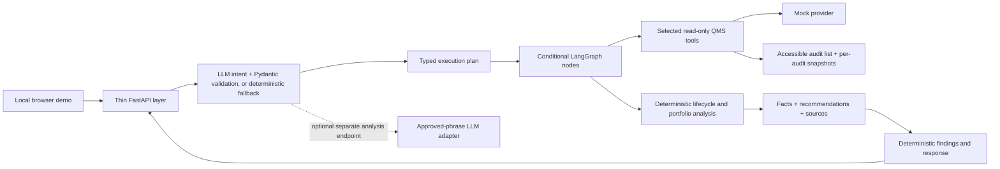

# QMS Audit Assistant MVP

A local, read-only audit assistant. Mock data is the default; an opt-in Django API provider supports authenticated reads from the existing QMS API. The agent never connects directly to the SQLite database.

## What is implemented

- FastAPI health, audit-list and audit-analysis endpoints, plus a browser demo at `/`.
- Pydantic models for audit, assignment, schedule, checklist, NC, analysis facts, recommendations and source references.
- Three synthetic audits representing pending assignment, assigned/scheduling prerequisites, and an in-progress audit with checklist and NC work.
- Mock provider interface and read-only audit, checklist, assignment, schedule and NC operations.
- Request-scoped Django API provider with JWT identity validation, audit resolution by ID/code, assignment/orientation, schedule/confirmation, aggregate checklist-progress and NC reads.
- Explicit Django GET allowlist. The protected audit checklist and checklist-item routes are never called; checklist analysis uses aggregate progress included in audit detail.
- Deterministic lifecycle analysis in `app/domain/`, independent from model calls.
- One LangGraph Audit Orchestrator with explicit load, analyze, explain/fallback and error handling nodes.
- LLM-assisted natural-language task understanding and structured tool proposals, validated with Pydantic and deterministic objective-specific tool requirements. Python preserves the audit reference and performs all QMS reads, calculations and permission checks.
- Optional OpenAI-compatible adapter for both task understanding and approved-phrase explanations. A task request makes at most one LLM call; task explanations remain deterministic. No API key is needed.

No write tools, RAG or multiple agents are included. In mock mode the local MVP has no authentication and must not be exposed as a production service. In Django mode each API request must include a QMS bearer token; the service validates it with `/api/auth/me/` and forwards it only to the Django provider for that request.

## Exact dependencies

Python 3.12+ is required. Pinned dependencies:

```text
fastapi==0.115.12
uvicorn[standard]==0.34.2
langgraph==0.4.8
pydantic==2.11.5
httpx==0.28.1
pytest==8.3.5
```

## Start the local demo

From this directory (`agent-service/`), create and activate an isolated environment, then install only into that environment:

```bash
python3 -m venv .venv
source .venv/bin/activate        # Windows PowerShell: .venv\Scripts\Activate.ps1
python -m pip install -r requirements.txt
uvicorn app.main:app --reload --port 8080
```

Open <http://127.0.0.1:8080/>. The API is documented at <http://127.0.0.1:8080/docs>.

The demo works without an LLM API key. It reports the mock provider as its data source and always computes business facts locally.

## Connect to the Django QMS API

Start Django locally, then run the agent with the existing API root (the URL must end in `/api/`):

```bash
export QMS_DATA_PROVIDER=django
export QMS_API_BASE_URL="http://127.0.0.1:8000/api/"
uvicorn app.main:app --reload --port 8080
```

Send the user's JWT on each agent API request. The service validates identity first and then uses the same request-scoped bearer token for allowlisted Django GETs. It does not log, return to the caller, pass to the LLM, or persist the JWT. Django remains responsible for per-user/object authorization. Use a test account and do not put a live token in source files or shell history.

For browser calls, the agent allows `http://localhost:5173` and `http://127.0.0.1:5173` by default. Set `AGENT_CORS_ORIGINS` to a comma-separated list of exact frontend origins when deploying elsewhere; do not use `*` for authenticated browser access. CORS permits only GET and POST with Authorization and Content-Type headers.

```bash
curl http://127.0.0.1:8080/api/audits \
  -H "Authorization: Bearer ${QMS_JWT}"

curl -X POST http://127.0.0.1:8080/api/tasks/execute \
  -H "Authorization: Bearer ${QMS_JWT}" \
  -H 'Content-Type: application/json' \
  -d '{"request_text":"Find compliance gaps for audit IA-2026-003","include_explanation":false}'
```

For a local test, load a short-lived test token into `QMS_JWT` without echoing it:

```bash
read -s QMS_JWT
export QMS_JWT
```

Set `QMS_DATA_PROVIDER=mock` (or omit it) to restore the synthetic provider and browser demo behavior. The Django API provider supports only read endpoints on its explicit allowlist; audit checklist item detail routes are intentionally excluded because their current authorization is insufficient.

## Optional LLM task understanding

Set the endpoint variables before starting the server to enable an OpenAI-compatible chat-completions endpoint. Choose a provider/model whose current plan fits your needs (including its free tier); the service does not select providers, switch endpoints, or fall back to a paid endpoint automatically.

```bash
cp .env.example .env  # load these values into your process environment separately
export LLM_API_KEY="your-provider-key"
export LLM_BASE_URL="https://provider.example/v1"
export LLM_MODEL="your-provider-model"
export LLM_TIMEOUT_SECONDS=8
export LLM_MAX_OUTPUT_TOKENS=120
uvicorn app.main:app --reload --port 8080
```

Task requests send only the user's request text in a compact prompt. The adapter expects a JSON object with an objective, allowed read-tool names and short rationale. Pydantic validates the response; Python rejects incomplete or unsupported tool sets and keeps the exact audit reference parsed from the original request. Timeouts (at most 8 seconds), provider/quota errors and invalid output immediately use the deterministic parser. Output tokens are capped (16–512, default 120). Missing configuration means deterministic parsing without a network call.

The LLM never supplies audit facts, calculations or permissions. The existing explanation adapter can only select reviewed local phrases for the separate audit-analysis endpoint. Task execution uses a deterministic explanation to stay within one model call. Keep API keys in the process environment; they are not logged or returned.

## API

| Method | Path | Purpose |
| --- | --- | --- |
| `GET` | `/api/health` | Health and provider type. |
| `GET` | `/api/audits` | List synthetic audits. |
| `POST` | `/api/audits/{audit_id}/analysis` | Return facts, recommendations, source references, unresolved policy and explanation. Set `?include_explanation=false` for strict deterministic wording. |
| `POST` | `/api/tasks/execute` | Understand a natural-language request, identify its audit/objective, select tools, execute a plan and return findings and provenance. |
| `GET` | `/` | Browser demo. |

Example:

```bash
curl -X POST http://127.0.0.1:8080/api/audits/audit-1003/analysis
curl -X POST http://127.0.0.1:8080/api/tasks/execute \
  -H 'Content-Type: application/json' \
  -d '{"request_text":"Find compliance gaps for audit IA-2026-003","include_explanation":false}'
curl -X POST http://127.0.0.1:8080/api/tasks/execute \
  -H 'Content-Type: application/json' \
  -d '{"request_text":"Which audit needs attention first and why?"}'
```

Supported objectives are audit analysis (`Analyze audit audit-1003`), pending-action identification (`Identify pending actions for audit audit-1002`), audit completion planning (`Plan to complete audit IA-2026-003`), compliance gap analysis (`Find compliance gaps for audit IA-2026-003`), and portfolio analysis (`Analyze all accessible audits`). Portfolio requests do not need an individual audit ID.

Portfolio results include ranked audits, per-audit factors and scores, recommendations, findings and source references. `portfolio_priority_method` describes the deterministic points and tie-break rules. Audits whose required data cannot be read are listed in `portfolio_failures` and excluded from ranking; the Django provider's permission-scoped audit list remains the source of accessible IDs. Each fact and recommendation carries references to its source records. `llm_used`, `planning_source` and `fallback_reason` identify the request-understanding path; portfolio analysis does not make per-audit LLM calls.

## Run automated tests

Activate the virtual environment, then run:

```bash
python -m pytest
```

Tests cover all sample workflow paths, read-only tool coverage, deterministic/no-key behavior, LLM phrase allowlisting and fallback, source references, API errors, listing and serving the browser demo. They use synthetic fixtures and do not access the QMS database.

## Architecture and future extension points



The provider protocol is the seam for future Django or other system providers; `ToolExecutionContext` carries identity/scope references separately from LLM-visible graph state. LangGraph checkpointer injection is optional but unused in this MVP, allowing a persistence backend to be added later. A human-approval interrupt can be inserted before any future action node; this MVP has no action nodes. These integration features are not enabled now. Business rules are derived from the existing QMS technical handoff, while role-policy discrepancies remain explicitly unresolved in the analysis response.
