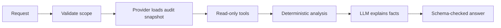

# Agent design guide

**Status: planned.** There is no Python agent implementation in the workspace. Version 1 is a single LangGraph Audit Orchestrator backed by a mock provider initially, then an authorized Django API provider. Tools are read-only. Python computes facts; an LLM explains those facts. No RAG, multiple agents or write operations.

## Concepts

- [LangGraph workflow](langgraph-workflow.md): graph nodes, branches and failure paths.
- [State management](state-management.md): bounded per-request context and output.
- [Data provider](data-provider.md): mock-first adapter and later Django API source.
- [LLM and token efficiency](llm-and-token-efficiency.md): model boundary, data minimization and cost controls.
- [Tools](tools/README.md): proposed read-only tool contracts.

The authoritative domain behavior is in the [QMS lifecycle](../domain/qms-audit-lifecycle.md). Backend permissions must be reconciled with current UI descriptions before agent integration; see [open questions](../decisions/open-questions.md).
