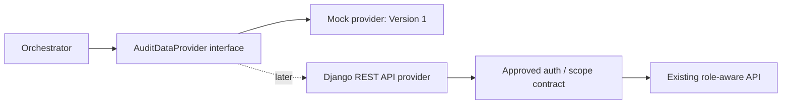

# Data provider

## Status and sequence

The provider abstraction and both providers are **planned**. Version 1 starts with deterministic mock fixtures. A Django API-backed provider is a later step after identity, authorization and endpoint contracts are settled. The agent must not connect directly to `Backend/db.sqlite3`.

## Proposed provider contract

Conceptually, the provider returns a normalized, bounded `AuditSnapshot` for a requested audit and caller scope. It may support `get_audit_snapshot(audit_id, caller_context)`, `get_checklist(audit_id, caller_context)`, and `get_non_conformities(audit_id, caller_context)`. These are Python interface proposals, **not HTTP endpoints** and not implemented functions.

The result should include only analysis needs: audit ID/code, status, planned dates, project/framework identifiers or names when justified, assignments and orientation status when visible, schedule and confirmations, checklist item IDs/codes/results, NC status and only approved text fields. Keep provenance/source IDs. Provider must distinguish not found, forbidden, unavailable and malformed data.

## Mock provider

Fixtures should be synthetic and deterministic, representing valid and edge-case QMS flows such as pending assignment, missing orientation, an unconfirmed schedule, pending checklist results, rework-required NC, and a closed audit. Tests should not depend on the development SQLite database or demo-user PII.

## Django API provider

When approved, call existing Django REST endpoints through a typed HTTP adapter, with timeouts and bounded responses. Use API authorization and role-scoped querysets. Do not issue raw SQL, import Django models across the service boundary, or reuse the SQLite file. The current QMS API has no dedicated agent endpoint and no service-to-service/delegated identity contract; see [integration](../integration/django-api-integration.md) and [open questions](../decisions/open-questions.md).

The current API offers `GET /api/audits/` and `GET /api/audits/{id}/`, with progress summary; audit checklist access is an auditor-only action while the audit is in progress. NC listing is scoped to QMS, assigned auditor or project member. These are user-facing role rules, not automatically a service credential strategy.

Related: [API integration](../integration/django-api-integration.md) · [permissions](../integration/authentication-and-permissions.md) · [state](state-management.md)
