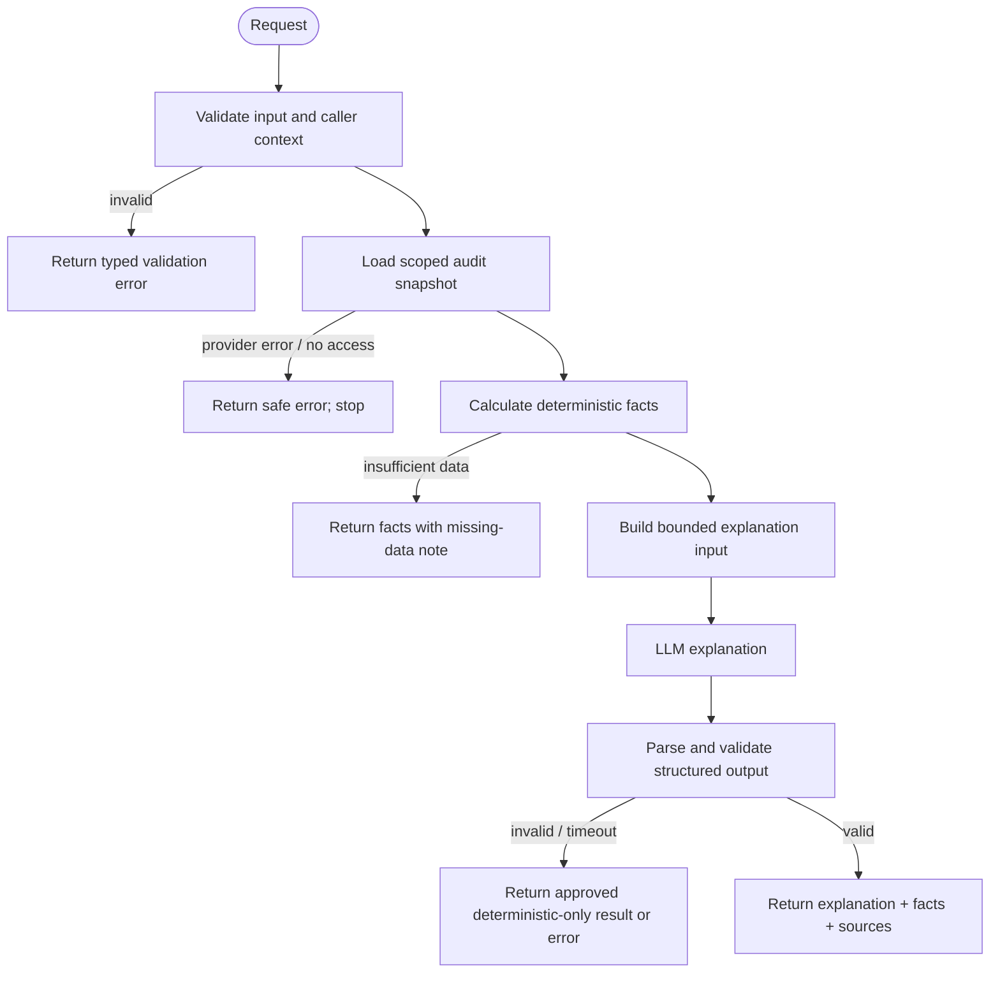

# LangGraph workflow

## Status

**Planned:** LangGraph is the selected workflow orchestrator. No graph or LangGraph dependency exists in the current project. One graph/one Audit Orchestrator is the Version 1 scope.

## Proposed graph

## Node responsibilities

1. **Validate request:** require audit identifier, supported analysis type and trusted caller context. Caller role is not accepted from untrusted request fields.
2. **Load context:** ask the provider for the minimum audit snapshot authorized for this caller. The provider owns source-system access; no model call yet.
3. **Calculate facts:** Python checks known state fields, counts and prerequisites. It does not duplicate or replace Django transition enforcement.
4. **Build explanation input:** pass only facts and approved relevant text. Mark source text as untrusted content.
5. **Explain:** request a constrained schema from the selected LLM. No tools exposed to the LLM in Version 1 unless a concrete need is approved; orchestration invokes tools deterministically.
6. **Validate output:** enforce schema, size, allowed claims and links to fact/source identifiers. Drop unsupported claims or fail safely.
7. **Return:** include deterministic facts separately from generated prose and indicate missing data.

## Retry and failure policy

Retry only transient provider/model errors with bounded attempts and timeout. Do not retry authorization or validation failures. Never fill missing data with model guesses. A deterministic-only fallback is a product/API decision, not assumed behavior; see [open questions](../decisions/open-questions.md).

## Example

If `AUD-101` is `ASSIGNED`, its schedule is not confirmed, and an auditor orientation is complete, Python can report those facts and identify the `start` prerequisites still missing. The LLM may explain the situation in plain language. Only Django's `start` action decides whether a start transition is allowed.

Related: [state](state-management.md) · [provider](data-provider.md) · [LLM boundary](llm-and-token-efficiency.md)
