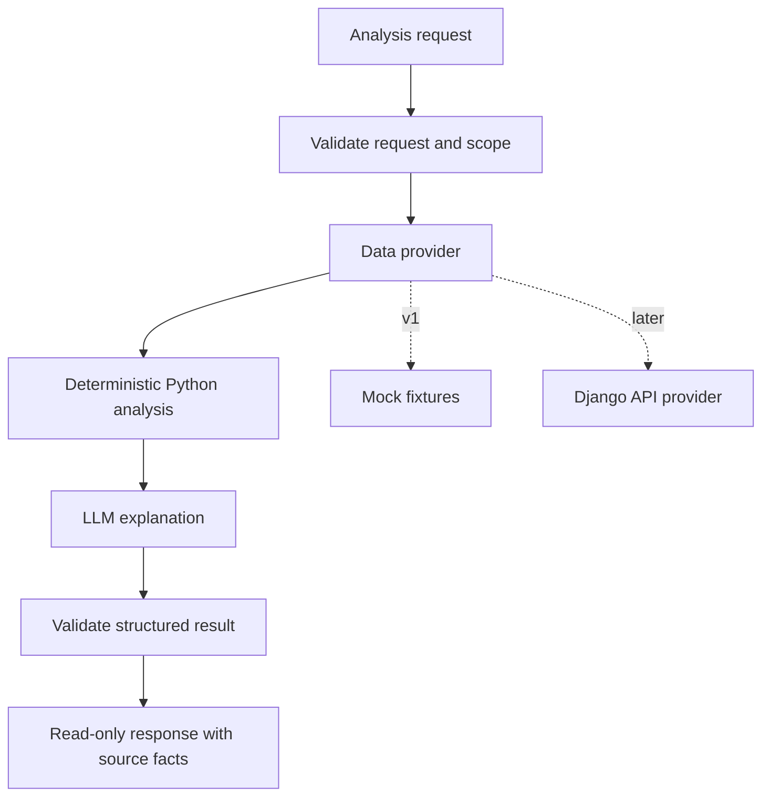

# Agent architecture

## Agreed Version 1 shape (planned)

One Python service contains one **Audit Orchestrator**, implemented with LangGraph. The orchestrator coordinates a bounded request: load audit context from a provider, compute factual summaries with deterministic Python, ask an LLM to explain those facts, and return a structured explanation. The first provider is a mock provider so workflow behavior can be developed without touching the QMS database or API. A Django API provider can replace/augment it later.

There are no agent files or AI dependencies in the current source. LangChain may be used where it provides a concrete integration benefit; it is not a requirement to wrap every component. Version 1 has no RAG, no multi-agent system, no write tools, and no agent-owned source of truth.

## Component responsibilities

| Component | Responsibility | Authority |
| --- | --- | --- |
| Request adapter (planned) | Validate an analysis request and caller context; expose a narrow service contract. | No QMS write authority. |
| Audit Orchestrator (planned) | Sequence provider, rules, explanation and output validation. | Does not decide access or mutate QMS state. |
| Data provider (planned) | Return a bounded, normalized audit snapshot. | Mock source first; later reads through authorized Django endpoints. |
| Deterministic analysis (planned) | Calculate counts, missing prerequisites, lifecycle facts, and rule-based flags. | Pure logic over supplied data; Django remains authoritative for transitions. |
| LLM adapter (planned) | Convert supplied facts into plain-language explanation. | Cannot invent or authorize state changes; output is validated. |
| Read-only tools (planned) | Offer narrow typed operations to the orchestrator. | No mutation, arbitrary database access, or unrestricted API calls. |

## Why separate service

LangGraph, Python model integrations and prompt handling can evolve independently while Django remains the QMS system of record. The boundary also makes permissions, input minimization and failure behavior explicit. This does not imply a separate database or a replacement frontend/backend. The decision and alternatives are in [ADR-001](decisions/ADR-001-separate-agent-service.md).

## Error and fallback behavior (proposal)

Provider errors should stop analysis with a safe, typed error; do not ask the model to fill missing facts. If the LLM is unavailable, deterministic facts may be returned only if the API contract explicitly supports a no-explanation result. Validate generated output against a schema and tie every conclusion to retrieved facts. These behaviors need implementation and tests before the service is used.

## Related documents

[Workflow](../agent/langgraph-workflow.md) · [State](../agent/state-management.md) · [Provider](../agent/data-provider.md) · [LLM boundaries](../agent/llm-and-token-efficiency.md) · [Security](security.md)
