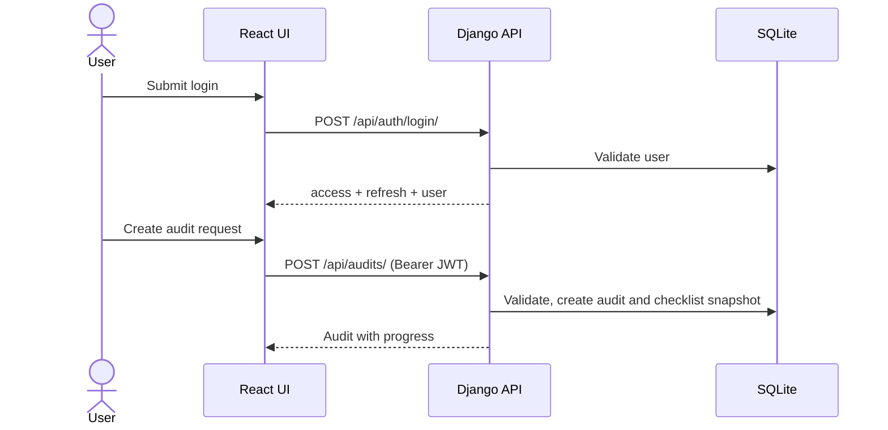
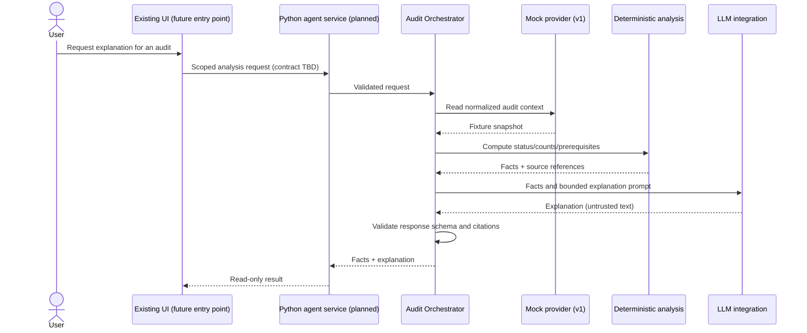

# Data flow

## Current application flow (implemented)

The user signs in through `POST /api/auth/login/`; the backend returns JWT tokens and serialized user data. The React client stores tokens in `localStorage`, adds the access token as a Bearer header and refreshes after a 401. API responses populate the relevant React page. On audit creation Django derives the department from the project and transactionally creates an audit-specific checklist from the active matching master checklist.

## Planned Version 1 agent flow

This request/result path is proposed; no agent endpoint is currently available. The UI/API entry point, caller-identity handoff and authorization contract must be decided before connecting a real provider. Version 1 development can exercise the same orchestration with mock fixtures.

In a later API-backed version, the provider fetches only the needed records from Django using an approved identity flow. It must not open `Backend/db.sqlite3`, and the LLM must not receive data beyond the approved context. No persistence, feedback, memory, or write path is defined for Version 1.

## Example: explain readiness to start

For audit `AUD-101`, deterministic code can inspect status `ASSIGNED`, both auditor orientation statuses, schedule status, confirmations and checklist existence. It can state which prerequisite is incomplete. The model can explain that in approachable language, but it cannot mark the audit started; Django's existing `start` action enforces assignment, completed orientation, confirmed schedule, checklist existence and `ASSIGNED` state.

## Related documents

[Lifecycle](../domain/qms-audit-lifecycle.md) · [Provider](../agent/data-provider.md) · [Django integration](../integration/django-api-integration.md) · [Security](security.md)
