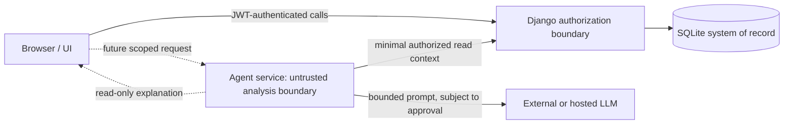

# Security architecture

## Implemented controls

- Django REST Framework uses JWT authentication by default (`Backend/config/settings.py`). Current token lifetimes are 30 minutes for access and 1 day for refresh.
- Role checks are implemented in `accounts/permissions.py`; individual views also scope querysets by role, assignment or project membership.
- The frontend adds a Bearer token and refreshes a failed request after a 401. Tokens and cached user data are stored in browser `localStorage`.
- CORS currently permits localhost Vite origins. Settings include `DEBUG = True`, a development-looking secret key, and development host/origin values; these settings are not a production security configuration.
- QMS state transitions and write permissions are implemented in Django views/serializers, not in frontend-only role gates.

## Planned agent controls

The future agent service must be a read-only consumer of approved QMS information. It must not access SQLite directly, hold Django's signing secret, or treat an LLM response as authorization. A trusted identity and permission handoff must be designed before the Django provider is implemented. See [authentication and permissions](../integration/authentication-and-permissions.md) and [API integration](../integration/django-api-integration.md).

Recommended controls to implement and verify:

- Minimize the context sent to the provider and model; define treatment of names, free-text remarks and NC descriptions.
- Keep model credentials outside source control and rotate them using the chosen deployment secret manager.
- Validate audit IDs and user scope server-side; avoid accepting a client-supplied role as proof of access.
- Use fixed, typed tool inputs; deny arbitrary SQL, shell, URL fetching and write operations.
- Apply request timeouts, size limits, rate limits, bounded retries and explicit cost/token budgets.
- Treat user-authored checklist remarks and NC content as untrusted data (including prompt injection attempts); keep instructions separate from retrieved text.
- Log request IDs, tool names, decision facts and error categories while avoiding secrets and unnecessary prompt/PII retention.
- Clearly label generated explanation as assistance; preserve deterministic facts and source references so a human can verify it.

These are design requirements, not features already deployed. Resolve retention and model-provider questions in [open questions](../decisions/open-questions.md).

## Threat boundary

The identity and API path from Agent to Django are unresolved. The browser should not be given provider secrets. Agent output must never be used as an implicit command to mutate audit records.
