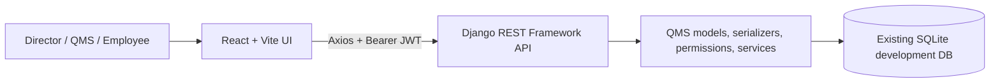
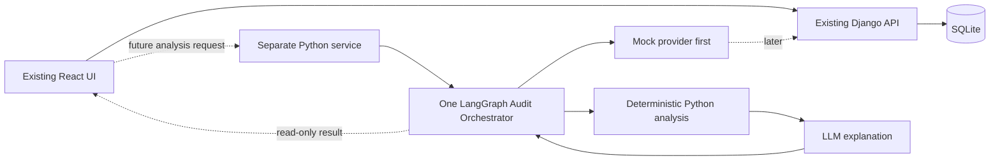

# System overview

## Status

**Implemented:** Django/DRF QMS backend, React/Vite frontend, JWT authentication, and SQLite development database. **Planned:** a separate Python agent service. The service does not exist in source yet.

## Current QMS application

The frontend calls the backend through Axios (`Frontend/src/api/client.js`, `Frontend/src/api/endpoints.js`). The configured API base defaults to `http://127.0.0.1:8000/api`; requests attach a JWT access token. Django routes authentication, project, framework/checklist and audit resources under `/api/` (`Backend/config/urls.py`). Django models and views own persistence, permissions, validation and audit state transitions. SQLite is configured at `Backend/db.sqlite3`.

The roles are `DIRECTOR`, `QMS` and `EMPLOYEE`. An employee can act as auditor only through an assignment; project membership represents the audited team. See [authentication and permissions](../integration/authentication-and-permissions.md).

## Planned agent boundary

The separate service keeps orchestration and model-provider code out of the existing QMS application. It will begin with mock data and read-only tools. A later Django API provider should use the API and its authorization boundary; it must not query the SQLite file directly. In Version 1, deterministic Python computes business facts and the LLM explains those facts. The QMS remains the authority and writes remain in the existing UI/API.

The dashed paths are planned; no agent route, service, provider, graph, or runtime is implemented. Read [agent architecture](agent-architecture.md), [data flow](data-flow.md), and [ADR-001](decisions/ADR-001-separate-agent-service.md).

## Existing integration facts

- Django's default DRF authentication is JWT; access tokens last 30 minutes and refresh tokens 1 day in current settings.
- Frontend token storage uses browser `localStorage` and refreshes access tokens after a 401.
- The database is SQLite, not an agent interface. Do not introduce shared DB access.
- Existing APIs contain role-scoped querysets and business checks. Reusing them preserves current rules, but service-to-service identity and delegated user authorization remain undecided.

## Related documents

[Audit lifecycle](../domain/qms-audit-lifecycle.md) · [Database models](../domain/database-models.md) · [Security](security.md) · [API integration](../integration/django-api-integration.md)
