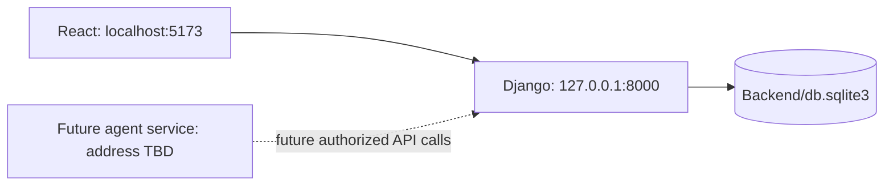

# Local setup

## Existing QMS prerequisites

The existing root README states Python 3.12+ and Node.js 20.19+ (or 22.12+). The backend pins Django 6.1.1, Django REST Framework 3.18.1, Simple JWT and related packages in `Backend/requirements.txt`. Frontend package versions are listed in `Frontend/package.json` and lockfile.

This documentation task did not install packages. Follow setup commands only when you intend to prepare a local development environment and are authorized to install dependencies. Keep the existing SQLite database intact.

## Backend

From workspace root:

```bash
cd Backend
python -m venv .venv
source .venv/bin/activate        # Windows PowerShell: .venv\Scripts\Activate.ps1
pip install -r requirements.txt
python manage.py runserver
```

The API defaults to `http://127.0.0.1:8000/api/`. SQLite is configured at `Backend/db.sqlite3`. The repository root README notes a dummy-user import command for an empty database; do not use it against the existing shared development DB without explicit intent. Do not delete, replace, or reset the database.

## Frontend

In a separate terminal:

```bash
cd Frontend
npm install
npm run dev
```

Vite defaults to `http://localhost:5173`. `VITE_API_URL` overrides the API base URL, which defaults to `http://127.0.0.1:8000/api`.

## Agent service

No `agent-service` package, dependency manifest, executable or environment configuration exists yet. Do not install LangGraph, LangChain or model SDKs as part of setup. When implementation is authorized, first design and review the package layout and dependency choices; then document the actual setup separately.

## Local service topology



Related: [root overview](../../README.md) · [testing strategy](testing-strategy.md) · [security](../architecture/security.md)
