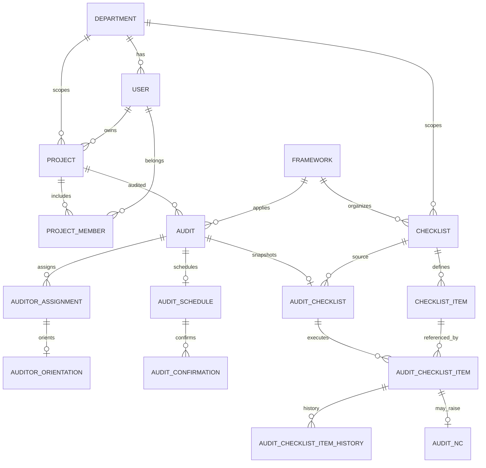

# Database models

## Scope

This describes Django ORM models in `Backend/accounts`, `projects`, `frameworks`, and `audits`. The configured development database is SQLite at `Backend/db.sqlite3`. This is a conceptual map; field definitions and migrations are authoritative. The planned agent has no tables and should not store a duplicate audit system.

## Entity summary

| Entity | Important attributes and relationships |
| --- | --- |
| `Department` | Unique name, optional description, active flag. Used by users, projects, checklists and audits. |
| `User` | Django `AbstractUser` with unique employee ID, role (`DIRECTOR`, `QMS`, `EMPLOYEE`) and optional department. |
| `Project` | Unique code, name, department, owner, status (`ACTIVE`/`INACTIVE`). |
| `ProjectMember` | One project and employee, POC type (`NONE`, `PRIMARY`, `SECONDARY`, `ADDITIONAL`). Constraints include unique project/employee, a global one-project membership per employee, and at most one Primary and one Secondary POC per project. |
| `Framework` | Unique code and name, description and active flag. |
| `Checklist` | Framework + department + name; unique framework/department pair; active flag. |
| `ChecklistItem` | Master checklist question, item code, order, active flag. Ordered by `order`. |
| `Audit` | Unique audit code, project, department, framework, creator, planned dates, status. Department is derived from project by creation flow. |
| `AuditSchedule` | One-to-one with audit, start/end, `PENDING`/`SCHEDULED`/`CONFIRMED`, scheduler; exposes T-15/T-7 date properties. |
| `AuditorAssignment` | Audit, employee auditor, PRIMARY/SECONDARY type, assigning user/time. Unique auditor per audit and unique assignment type per audit. |
| `AuditorOrientation` | One-to-one with assignment, PENDING/COMPLETED and completion time. |
| `AuditConfirmation` | Schedule, COMBINED/INDIVIDUAL type, confirmer/time; unique confirmation type per schedule. |
| `AuditChecklist` | One-to-one with audit and reference to the source master checklist. |
| `AuditChecklistItem` | Audit-specific item result (PENDING/COMPLIANT/NON_COMPLIANT), remarks, and source master item. Unique per audit checklist/item. |
| `AuditChecklistItemHistory` | Item, remarks, evaluating user and timestamp. Created when an item enters NON_COMPLIANT. |
| `AuditNC` | One-to-one with item; finding, risk action, team correction/actions, status (OPEN/SUBMITTED/REWORK_REQUIRED/ACCEPTED), verifier, verification time/remarks. |

## Snapshot semantics and limitations

At creation, the service copies active master checklist items into execution rows. The row still references the source item for item code/question, so it is an execution snapshot of which rows were selected, not an immutable copy of every question field. Editing a master question later may affect the displayed question through that relation. No explicit checklist version model or evidence attachment model appears in these apps. The implications should be resolved before relying on historical content; see [open questions](../decisions/open-questions.md).

## Agent implications

The provider should build a bounded DTO from authorized API responses rather than expose Django models to the LLM. Preserve IDs/statuses/source references for traceability, calculate summaries from records, and avoid unnecessary user or free-text fields. There are no agent-owned persistence models in Version 1.
