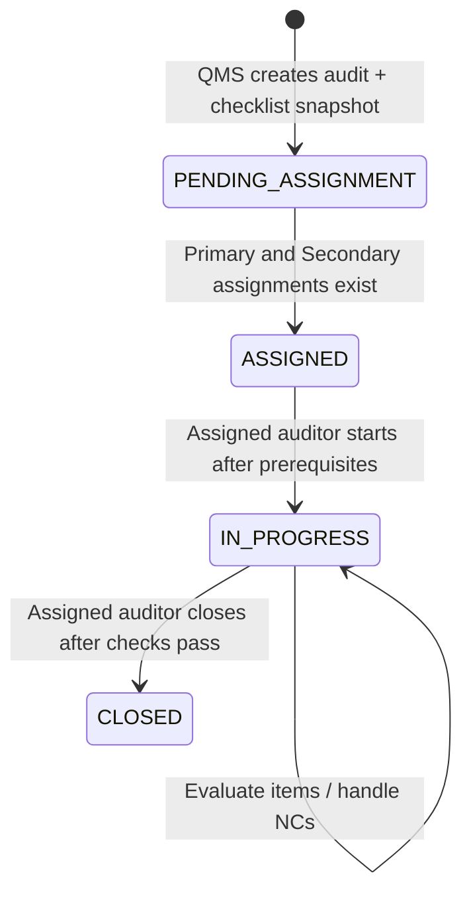

# QMS audit lifecycle

## Status and source

The steps below are implemented across `Backend/audits/models.py`, `views.py`, `serializers.py`, `services.py`, and `Frontend/src/workflow.js`. Role descriptions follow backend enforcement. There are discrepancies around who verifies NCs and closes audits; see [open questions](../decisions/open-questions.md).

## Lifecycle at a glance

The model declares `DRAFT` and `PENDING_CLOSURE` too, but current creation starts at `PENDING_ASSIGNMENT` and current close goes directly from `IN_PROGRESS` to `CLOSED`. No current code uses `PENDING_CLOSURE` as a transition.

## Steps and guards

1. **Prepare a project (Director).** A Director creates and manages a project and its members. Audit creation requires exactly one Primary and one Secondary POC on the selected project. The auditor candidates are employees who are POCs on a different project and do not already have an active audit assignment.
2. **Create audit (QMS).** QMS selects an active project, active framework, and planned start/end dates (end after start). Django derives audit department from the project, sets `PENDING_ASSIGNMENT`, and creates an audit checklist in the same transaction. The service selects the active checklist for that framework and department and copies each active master item into an `AuditChecklistItem` with result `PENDING`. If none exists, creation fails.
3. **Assign two auditors (QMS).** Assignments must each be one PRIMARY and one SECONDARY. Auditor must be an Employee with a valid POC membership on another project and cannot be assigned to another non-closed audit. Each assignment creates a pending orientation. The audit becomes `ASSIGNED` when both assignment types exist.
4. **Complete orientation (assigned auditor).** An auditor can complete their own orientation. Both should be complete before the service starts, but the `start` action checks the requesting auditor's own orientation.
5. **Schedule and confirm (QMS).** An audit has at most one schedule. End must be after start. The model exposes T-15 and T-7 dates relative to scheduled start. QMS records one COMBINED and one INDIVIDUAL confirmation; the schedule becomes `CONFIRMED` when both exist.
6. **Start (assigned auditor).** `POST /api/audits/{id}/start/` requires the caller be assigned, their orientation be complete, a schedule exist and be confirmed, a checklist exist, and audit status be `ASSIGNED`. It changes status to `IN_PROGRESS`.
7. **Evaluate checklist (assigned auditor).** The checklist can be retrieved and items patched while the audit is in progress. Result is PENDING, COMPLIANT, or NON_COMPLIANT. A compliant item cannot be re-evaluated. A non-compliant item creates a history record and one NC. It cannot become compliant until its NC is `ACCEPTED`.
8. **Resolve NC.** The auditor fills `finding` and `risk_action`. Project members fill `correction`, `corrective_action`, and `preventive_action`. Current backend code says QMS has read-only access to NCs; an assigned auditor can submit `ACCEPTED` or `REWORK_REQUIRED` verification after correction or corrective action is present. This is inconsistent with frontend product language that assigns verification to QMS.
9. **Close.** The current endpoint allows an assigned auditor (not QMS, despite frontend comments) to close only from `IN_PROGRESS`, when there is at least one checklist item, every item is COMPLIANT, and all NCs are ACCEPTED. It sets `CLOSED`.

## What an agent can safely explain

The agent may summarize read-only facts such as “two checklist items remain pending” or “this audit is assigned but the current user's orientation is pending” if the provider supplies those scoped records. It must not infer missing data, change status, accept an NC, or claim that a QMS user can perform an action unless the business rule is reconciled. See [agent tools](../agent/tools/README.md).
